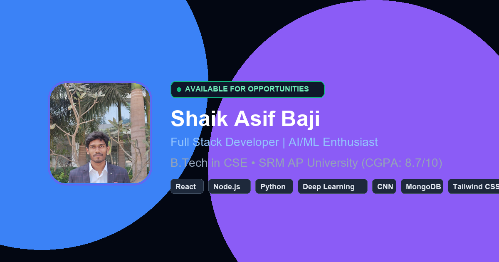

# Personal Developer Portfolio – Shaik Asif Baji



> A modern, responsive personal portfolio website designed to showcase my technical skills, software development projects, educational background, internship experience, and professional contact information.

[](https://react.dev/)
[](https://vitejs.dev/)
[](https://tailwindcss.com/)
[](https://opensource.org/licenses/MIT)

---

## 🚀 Project Overview

This portfolio website serves as an interactive hub highlighting my journey as a **Full Stack Developer** and **AI/ML Enthusiast** graduating from **SRM AP University**. It bridges scalable frontend and backend engineering with applied deep learning neural networks.

---

## 🛠️ Tech Stack

- **Frontend Library:** [React.js](https://react.dev/) (v18)
- **Build Tooling:** [Vite](https://vitejs.dev/)
- **Styling:** [Tailwind CSS](https://tailwindcss.com/) & Glassmorphism
- **Language:** JavaScript (ES6+)
- **Icons:** [Lucide React](https://lucide.dev/)
- **Animation & FX:** Framer Motion, Canvas Confetti
- **Email Service Integration:** [EmailJS](https://www.emailjs.com/) & Mailto Fallback

---

## ✨ Key Features

- **Responsive Modern UI:** Fully adaptive design tailored for mobile, tablet, and widescreen desktop experiences.
- **Professional Profile & Hero:** Displays authentic portrait photograph with an ambient glowing border, floating technology badges, and dynamic typewriter title animator.
- **About Me Section:** Highlights core competencies, degree credentials, and an interactive TypeScript developer profile terminal card.
- **Technical Skills Showcase:** Categorized skill cards with filter pills covering Programming, Frontend, Backend, Database Systems, AI & Machine Learning, and Developer Tools.
- **Projects with Verified GitHub Repositories:**
  - **E-Commerce Resale App (Make A Deal):** MERN stack marketplace with auth, listings, and admin panel.
  - **Rice Leaf Disease Prediction:** CNN architecture with InceptionV3 transfer learning (~85% accuracy).
  - **EEG-Based Depression Detection:** CNN encoder-decoder deep learning model (98.79% accuracy).
  - **Automatic Number Plate Recognition (ANPR):** Real-time OpenCV & YOLO vehicle identification.
  - **Agriconnect (Smart Agriculture Portal):** ML crop recommendation, Stripe payments, and OpenAI assistant.
  - **Team Task & Workflow Manager:** Collaborative project sprint board.
- **Deep Dive Project Modal:** In-depth view exploring key features, architecture, and tech stacks.
- **Experience & Education Timeline:** Showcases internship contributions at **Edunet Foundation** and B.Tech CSE coursework at **SRM AP University** (CGPA: 8.7 / 10).
- **Interactive Contact Hub:** Validated contact form, one-click copy buttons for email/phone with visual confirmation, and celebratory confetti dispatch.
- **Dark & Light Mode:** Theme switcher with automatic `localStorage` persistence.
- **Resume Download:** Direct access to download the latest curriculum vitae (`Shaik_Asif_Baji_Resume.pdf`).

---

## 📸 Screenshots & Previews

| Hero & Profile Preview | Portrait Headshot |
| :---: | :---: |
|  |  |

---

## 📂 Project Structure

```
asif-portfolio/
├── public/
│   ├── asif-avatar.jpg              # Square profile avatar
│   ├── asif-photo.jpg               # High-resolution portrait photograph
│   ├── favicon.svg                  # Custom branded SVG favicon
│   ├── preview-banner.png           # Portfolio preview banner
│   └── Shaik_Asif_Baji_Resume.pdf   # Direct download PDF resume
├── src/
│   ├── components/
│   │   ├── Navbar.jsx               # Navigation bar, mobile drawer & theme switcher
│   │   ├── Hero.jsx                 # Hero banner with photograph, typewriter & CTAs
│   │   ├── About.jsx                # Professional summary & code snapshot card
│   │   ├── Skills.jsx               # Categorized skills grid & filter tabs
│   │   ├── Projects.jsx             # Project cards, GitHub buttons & modal
│   │   ├── Experience.jsx           # Industry internship timeline
│   │   ├── Education.jsx            # Academic degrees & coursework highlights
│   │   ├── Contact.jsx              # Validated contact form & quick info cards
│   │   └── Footer.jsx               # Quick navigation, social icons & back-to-top
│   ├── data/
│   │   └── portfolioData.js         # Centralized portfolio data source
│   ├── App.jsx                      # App root component with theme state
│   ├── index.css                    # Tailwind directives & glassmorphism utilities
│   └── main.jsx                     # Application bootstrap with Error Boundary
├── index.html                       # HTML5 entry template & SEO metadata
├── package.json                     # Node.js dependencies and scripts
├── postcss.config.js                # PostCSS plugins configuration
├── tailwind.config.js               # Tailwind design system extensions
├── vite.config.js                   # Vite bundler configuration
└── README.md                        # Documentation
```

---

## 💻 Installation and Setup

Follow these steps to run the project locally on your machine:

### 1. Clone the Repository
```bash
git clone https://github.com/asifbaji-shaik/asif-portfolio.git
cd asif-portfolio
```

### 2. Install Dependencies
```bash
npm install
```

### 3. Start the Development Server
```bash
npm run dev
```
Open your browser and navigate to `http://localhost:3000`.

### 4. Build for Production
```bash
npm run build
```

### 5. Preview Production Build
```bash
npm run preview
```

---

## 👨‍💻 Author

**Shaik Asif Baji**
- **Title:** Full Stack Developer | AI/ML Enthusiast
- **Education:** B.Tech in Computer Science and Engineering, SRM AP University
- **Email:** [asifbajishaik33@gmail.com](mailto:asifbajishaik33@gmail.com)
- **GitHub:** [https://github.com/asifbaji-shaik](https://github.com/asifbaji-shaik)
- **LinkedIn:** [https://www.linkedin.com/in/shaik-asif-baji-135490240/](https://www.linkedin.com/in/shaik-asif-baji-135490240/)

---

## 📄 License

This project is open source and available under the [MIT License](LICENSE).
